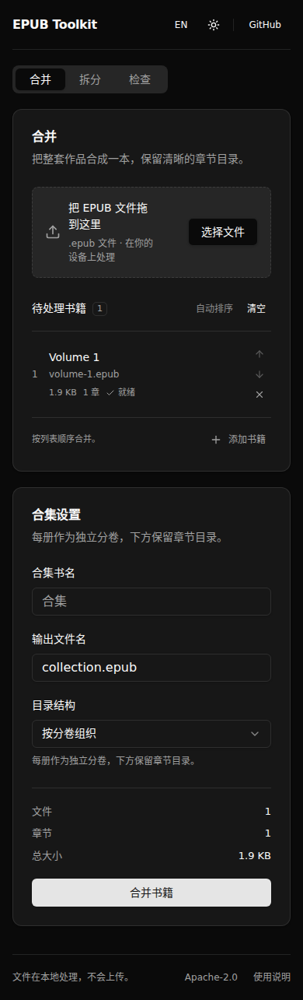

# EPUB Toolkit

A small workspace for your digital library. Merge EPUB volumes, recover individual books, and explore their contents — on your own device.

合并 EPUB 分卷、恢复单册、查看书籍结构。支持中英文、明暗主题和离线使用。


## What it does

| Tool | Use it for |
| --- | --- |
| **Merge** | Combine volumes in your chosen reading order. Group the table of contents by book or use a continuous chapter list. |
| **Split** | Reconstruct the volumes of an EPUB merged with this tool. Download each book or take all of them in one ZIP. |
| **Inspect** | Read the title, author, language, package version, reading order, and navigation of an ordinary or merged EPUB. |

The workspace supports drag and drop, automatic volume sorting, manual reordering, cancellation, English and Chinese, and light and dark themes. It also works on a phone. File reordering, menus, task states, and output panels use short animations and respect reduced-motion preferences.

EPUB 2 NCX and EPUB 3 navigation are supported. Resource handling covers XHTML, CSS, images, SVG references, and plain fonts, including nested relative paths. Matching binary images and fonts are stored once in a merged book.

**Split reconstructs book content and assets from the merge record.** Package metadata and ZIP serialization are rebuilt. It does not reproduce the original file byte for byte or infer chapter splits for an arbitrary book. The tool targets reflowable EPUBs; encrypted books and obfuscated fonts are not supported.

## Privacy and offline use

Book files stay in browser memory and are processed in a Web Worker. There is no upload endpoint, account, analytics, or server-side storage. Language and theme preferences are saved on the device.

After the app reports that it is ready for offline use, it can be reopened without a connection. The app shell and processing code are cached; your books are not. Supported browsers offer **Install app**. Safari users can use the browser's Add to Dock or Add to Home Screen command. Updates appear as an explicit prompt.

## Run the web app

Requires Node.js 22.12+ and npm.

```sh
npm ci
npm run dev:web
```

Open the local URL printed by Vite. For a production preview:

```sh
npm run build:web
npm run preview:web
```

### GitHub Pages

The **Deploy Web UI to GitHub Pages** workflow is manual. It checks and builds the app at `/lightweight_epub_merge_tool/`, then deploys `dist-web/`. The Worker, icons, manifest, and service worker use this same base path.

To deploy a reviewed version, select **Actions → Deploy Web UI to GitHub Pages → Run workflow**. Use the Pages URL returned by that run. The repository's current `github-pages` environment restricts deployments to approved branches. A feature branch must meet those environment rules before it can deploy there. Review and merge the source changes before updating the main site; a separate preview can be hosted independently.

## Python CLI

Requires Python 3.10+. The Python CLI has no runtime dependencies.

Install from a checkout:

```sh
python -m pip install .
```

Or install a wheel from the release-package workflow. The repository is not published to PyPI by this workflow.

```sh
# Infer order from filenames, book titles, or volume numbers.
epub-merge merge collection.epub volume-1.epub volume-2.epub --title "Collected stories"

# Preserve the order given on the command line.
epub-merge merge collection.epub first.epub second.epub --input-order --structure flat

# Recover each source volume.
epub-merge split collection.epub --out-dir recovered

# Inspect any supported EPUB.
epub-merge inspect volume-1.epub
```

`python -m epub_merge_tool` provides the same commands. Automatic sorting reports ambiguous volume numbers; use `--input-order` to supply the intended order. The legacy `--heuristic` option copies an ordinary book as one output; it does not infer chapter boundaries.

## Node and TypeScript

The browser Worker and Node CLI share `ts/src/`.

```sh
npm run build:ts
node dist-ts/src/cli.js merge collection.epub volume-1.epub volume-2.epub
node dist-ts/src/cli.js split collection.epub --out-dir recovered
node dist-ts/src/cli.js inspect collection.epub
```

The core exports `mergeEpubs`, `splitEpub`, `inspectEpub`, `readSourceBook`, and `readBookSummary`. Inputs and outputs use `Uint8Array`; no DOM or browser globals are needed by the core. The Python implementation retains its standard-library-only installation, and interoperability tests cover merge/split in both directions.

## Development checks

```sh
npm run verify                         # Types, core/CLI tests, and both builds
npx playwright install chromium        # One-time browser setup
npm run test:e2e                        # Production UI, Downloads, Pages path, offline Worker
```

Tests generate small EPUBs at runtime. To include output validation with [EPUBCheck](https://github.com/w3c/epubcheck):

```sh
EPUBCHECK_JAR=/path/to/epubcheck.jar npm test
```

CI runs this validation for EPUB 2/3 merge and split outputs, plus Python interoperability and browser tests. Inspect provides a structural overview; EPUBCheck provides specification validation.

The manual **Build release packages** workflow produces a wheel, source archive, and static web build as downloadable artifacts. It checks an installation of the built wheel in a fresh virtual environment and does not publish a release or deploy a site.

See [architecture and design decisions](docs/architecture.md) for resource mapping, memory use, and task cancellation.

<details>
<summary>Mobile workspace in dark mode</summary>



</details>

## License

Apache-2.0. The adapted shadcn/ui components retain their [MIT notice](THIRD_PARTY_NOTICES.md).
